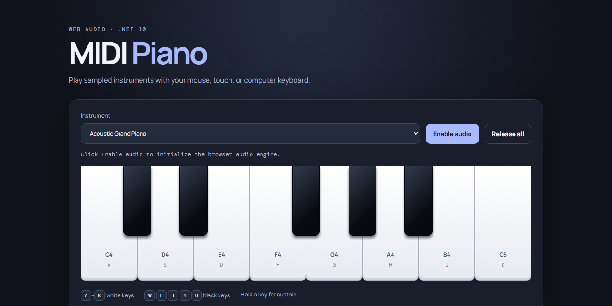

# MIDI Piano


[](LICENSE)
[](https://github.com/kreaton/MidiPiano/stargazers)

⭐ If MIDI Piano is fun to play with, [star it on GitHub](https://github.com/kreaton/MidiPiano). It's free, made by one developer, and stars are how other people find it.



**Play sampled instruments (piano, organ, guitar, strings, flute and more) in the browser with the mouse, touch or the computer keyboard.**

▶️ **Try it:** <https://kreaton.github.io/MidiPiano/>

It is a Blazor WebAssembly app (.NET 10) that runs entirely in the browser, with no server or backend. The sound comes from real instrument samples (the FluidR3_GM SoundFont), played with Web Audio through [soundfont-player](https://github.com/danigb/soundfont-player).

## What's in it

- **One octave, C4 to C5**, drawn in HTML and CSS. Play it by clicking or touching the keys, or from the computer keyboard: `A S D F G H J K` for the white keys and `W E T Y U` for the black keys. Holding a key sustains the note.
- **12 instruments**: acoustic grand, electric piano, honky-tonk piano, drawbar organ, nylon and clean electric guitar, violin, cello, string ensemble, flute, trumpet and synth strings.
- **Release all** stops every sounding note. Notes are also released when the window loses focus.

## Caveats

- The instrument samples are not part of the app. They are fetched from [gleitz/midi-js-soundfonts](https://github.com/gleitz/midi-js-soundfonts) on GitHub Pages the first time each instrument is used, so the app needs a network connection to make sound.
- Browsers only allow sound after a user gesture, so press **Enable audio** once before playing.
- The app can be installed from the browser (it has a web manifest), but it has no service worker, so it needs a connection to start.
- Despite the name, the app does not read MIDI files or MIDI devices: "MIDI" refers to the General MIDI instrument set and note numbers it plays.

## Project layout

```
MidiPiano.slnx
Directory.Build.props  Version numbering and build-date stamp
src/MidiPiano/
  App.razor          Router
  Layout/            MainLayout: page frame and footer (sample credit, version, GitHub link)
  Pages/             Home (the piano) and NotFound
  BuildInfo.cs       Version, build time and commit shown in the footer
  wwwroot/
    index.html       Host page, <base href>, loading screen
    css/app.css      All styling
    js/pianoAudio.js Audio adapter called from C#: loads instruments, note on/off, computer-keyboard input
    js/lib/          soundfont-player (MIT) and its licence
    fonts/           Manrope and DM Mono (SIL OFL) and their licences
    manifest.webmanifest
    icons/           App icons and favicon, rendered from art/icon.svg
art/icon.svg         Source of the app icon
tools/
  make-icons.ps1     Renders the PNG icons from art/icon.svg
  make-banner.ps1    Takes the README banner (images/banner.png) from the running app
.github/
  workflows/deploy.yml  Build and deploy to GitHub Pages
  workflows/codeql.yml  CodeQL code scanning
  dependabot.yml        Weekly NuGet and monthly GitHub Actions updates
```

## Running locally

Requires the [.NET 10 SDK](https://dotnet.microsoft.com/download).

```bash
dotnet run --project src/MidiPiano
```

Then open http://localhost:5288.

Stop the app before building it again. A running dev server keeps the list of files it started with, and after a rebuild the page can hang while loading.

## Publishing

Pushing to `main` builds the app and deploys it to GitHub Pages (<https://kreaton.github.io/MidiPiano/>) with [`.github/workflows/deploy.yml`](.github/workflows/deploy.yml). The version is `1.0.<run number>`, set in [`Directory.Build.props`](Directory.Build.props), and shown in the footer with the build time and commit.

Pages serves the app from `/MidiPiano/`, so the workflow rewrites `<base href="/" />` in `index.html` to match. It also tags the app's own scripts and stylesheet with the commit so browsers fetch the new version after a deploy.

## Icons and banner

Both are made with Windows PowerShell and headless Edge:

```bash
powershell -File tools/make-icons.ps1
powershell -File tools/make-banner.ps1   # with the app running on localhost:5288
```

## License & Authorship

This project is distributed under the terms of the [MIT License](LICENSE).

**AI authorship note:** Most of the source code in this repository was generated with AI coding agents (Claude Code), under my direction and review. Purely AI-generated material may not be eligible for copyright protection in some jurisdictions. To the extent any part of this project is protected by copyright, it is licensed under the MIT License, and the license's warranty and liability disclaimers apply to the project as a whole.

<!-- notices:start -->
### Independent development

MidiPiano is an independent, personal project developed by Per Hejndorf. It is not affiliated with, endorsed by or sponsored by Microsoft, The MIDI Association, AMEI, GitHub or any other rights holder. Product names and logos are trademarks of their respective owners and are used only to identify the services and tools the project works with.

### Third-party notices and asset provenance

[THIRD-PARTY-NOTICES.md](THIRD-PARTY-NOTICES.md) lists every third-party library, font and online service the project uses, with version, licence, source and whether it was modified. It also records where the icons, images, audio and video came from and how they are licensed. The instrument samples are the FluidR3_GM SoundFont, released under CC BY 3.0 and served by [gleitz/midi-js-soundfonts](https://github.com/gleitz/midi-js-soundfonts).
<!-- notices:end -->
